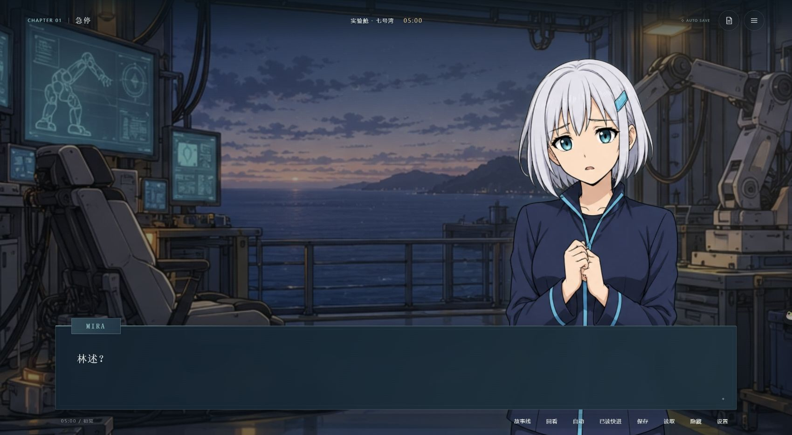
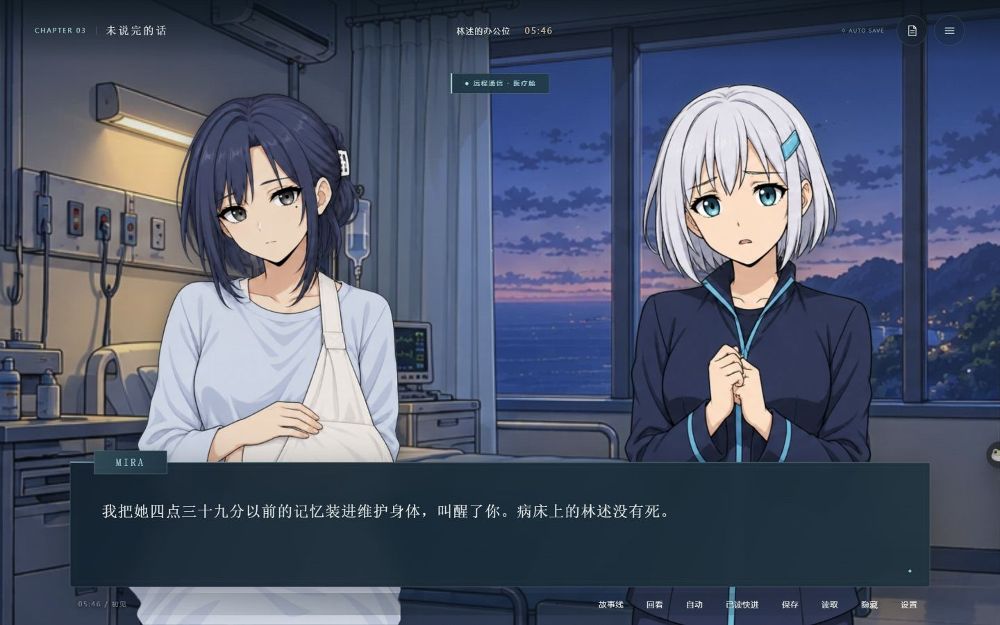
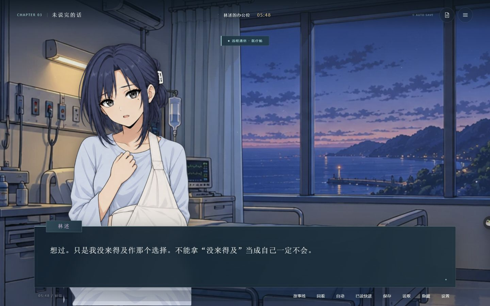
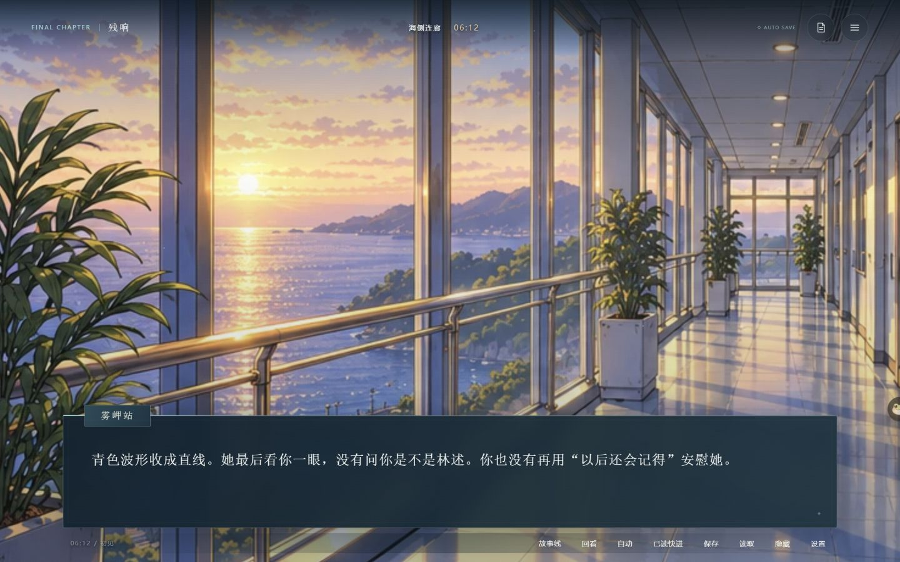
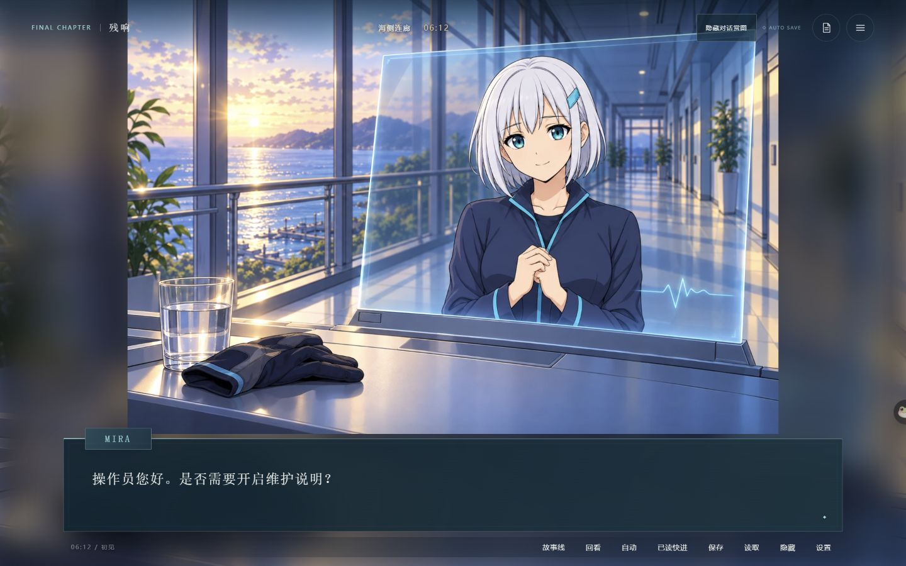
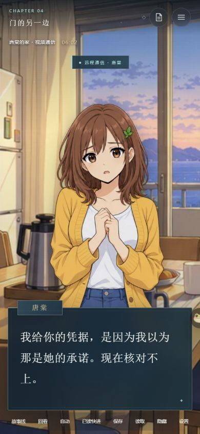

# 角色演出 · 2026-10-28

本轮在现有立绘上增加角色专属轻动效，以及13个场景中的31处段落演出标记。原画、剧情文字、段落顺序、选择规则与存档协议保持不变；没有新增运行依赖。

## 玩家可见的变化

| 人物 | 日常节奏 | 关键反应 |
| --- | --- | --- |
| MIRA | 缓慢、小幅的投影漂浮 | 身份揭露时影像短暂偏移，告别时靠近并渐隐，重置后进入原有静态CG |
| 林述 | 平缓呼吸，医疗场景使用更小幅度 | 回避时收缩，承认事故责任时停顿后向前，始终使用对应的医疗／历史立绘 |
| 唐棠 | 很轻的姿态变化 | 察觉冒名时先停止动作，再在核对凭据时后撤；真实联系时缓和姿态 |
| 周衡 | 更慢、较克制的呼吸 | 拒绝时迟疑，交出记录和分别签字时转为承担的姿态；受伤画面使用弱呼吸 |

CG优先展示，期间角色立绘隐藏并暂停动作。重置CG从问候延续至结局，保留其静态构图；不会强行插入立绘或让重置前的表情叠回CG。自然眨眼、口型和局部头发动画需要补充差分或拆层素材，不在本轮现有立绘演出的实现范围内。

## 制作与实现

在原段落中添加可选的`stage`，不增加段落、不更改`when`，例如：

```json
"stage": {"mira": "desync"}
```

人物ID为`mira`、`lin`、`tang`、`zhou`。支持`hesitate`、`recoil`、`admit`、`resolve`、`desync`、`farewell`、`shutdown`、`restore`、`settle`和`hold`。生成器及运行资源检查均拒绝未知人物或标记，失败时保留上一份有效输出。

姿态继承当前场景已实际显示的段落标记，读档和回溯时重新计算。一次性动作只在当前段落触发，不因设置、恢复前台或关闭菜单重播。CG上的段落标记保留其后续姿态含义，CG本身使用原有画面过渡。

`src/character-motion.js`只管理展示：独立的姿态、一次性动作、待机和图片淡换层避免争用同一个transform。没有以动画完成为条件阻挡阅读，也不把演出状态写入存档。图片解码使用当前请求及最新段落的回调，快速点击不会补播已经越过的动作。

打开菜单、确认框、章节幕、结局页，进入后台、已读快进和CG时暂停；减少动态效果时关闭角色动作及姿态位移，保留剧情所需的隐藏状态。切换场景和销毁游戏时取消一次性动作、清理观察器与监听。

## 验收



- `npm run check`：16个运行模块、样式及生成数据检查通过。
- `npm test`：34项通过，包含原有31项；新增角色方向、暂停／快进／减少动态／释放，以及慢速图片解码回调检查。
- 全部228份旧存档往返和43个生产美术SHA-256检查继续通过。
- Edge通过正常导入界面，实际检查身份揭露、林述承认、周衡签字、唐棠停顿与后撤、MIRA渐隐和重置CG；菜单暂停后动作停止，关闭后恢复待机。减少动态效果时没有角色动画或姿态位移。
- 1440×900、390×844、844×390布局检查；后台切换和快进取消动作另由生命周期测试验证。

| 身份揭露 | 林述承认 |
| --- | --- |
|  |  |

| MIRA渐隐后 | 重置静态CG |
| --- | --- |
|  |  |



本地预览和开发分支包含本轮演出；main合入与线上部署仍单独处理。
