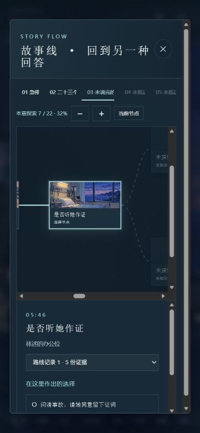
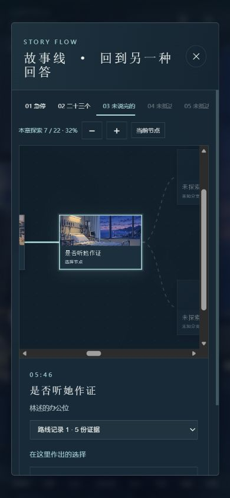
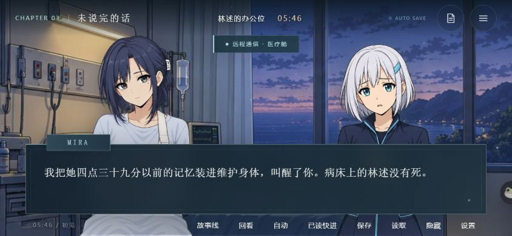

# 工程重构与剧情深化验收 · 2026-10-28

基线为 `07c0697a9ed1c0bab51fc17caee5464c93d3ddfe`，任务分支为 `codex/canxiang-refactor`。本记录描述本地验证；推送开发分支不代表 GitHub Pages 的 main 已经更新。

## 自动化结果

- `npm run check` 通过：UTF-8 章节生成与已提交数据一致；5章、95场景、6结局及全部美术引用通过；16个运行模块的语法、相对模块路径和样式入口有效。
- `npm test`：34项通过。原有19项断言保留，新增兼容、事务失败、损坏原文恢复、编码、原子生成、生命周期、分支对白及角色演出检查。
- 原有因果遍历覆盖97,333个不同状态；包含对白变体依赖的遍历覆盖97,429个不同状态，验证未联系唐棠、未威胁周衡等路线不会出现虚构的前置经历。
- 228份在旧实现上生成的v2存档，覆盖各章、段落边界、选择、CG、六结局、手动槽与节点快照，读取和导入导出保留内容。场景ID、段落顺序与条件、选项ID与因果规则保持一致。
- 43个生产美术文件的SHA-256与基线一致。清单见 `baseline.json`，旧剧情与存档样本以gzip保存在测试夹具中。
- Windows CP936默认环境和UTF-8模式生成结果字节一致；无效源数据不会覆盖已有输出。临时文件在同一目录原子替换，Git文本统一LF。
- 错误选择记录、越界段落、异常设置、回看、已读索引、节点快照以及持久化失败，均不能替换原存档。损坏原文逐字保留，可与内存进度分别导出。
- `git diff --check` 通过。

## 浏览器实际操作

使用本机Microsoft Edge，通过游戏正常界面操作，并导入旧版样本；没有通过调试对象跳过存读档界面。

- 旧进度继续、打字显示、即时显示、手动槽覆盖与读取、刷新恢复通过。
- 六种旧版结局样本均实际续读到相应结局页；这是结局段落的浏览器验证，完整路线可达性由因果遍历验证。
- 数字键选择、自动阅读推进、菜单打开后停止自动阅读、已读快进遇到未读内容停止通过。
- 开启限时救援后打开菜单，倒计时保持25秒；返回后可通过数字键正常救援。后台取消推进、保存、暂停与恢复音频及监听释放另由生命周期单元测试验证。
- 异常文件导入在面板内显示“导入失败：选择记录无效”；关闭面板后仍能继续原段落。
- 从第三章读档后，回到第一章节点改选，正确恢复早期状态；手机端关闭及回溯后面板均隐藏。
- CG隐藏对话赏图、恢复对话、已读画面解锁和未读画面隐藏通过。
- 音量滑杆及其保存通过。本轮没有进行主观听感评价，也没有重新运行全部旧版美术／音频截图脚本。
- 1440×900桌面、390×844竖屏、844×390横屏无页面横向溢出；横屏阅读控件在可视区域内。
- 同一第三章段落，桌面对话区、对话框、立绘容器、左右站位、顶栏和快捷菜单的几何尺寸与基线一致。手机剧情图改为面板纵向阅读与地图自身平移，详情区不再独立滚动。
- 最终检查未出现页面console error/warn。历史浏览器脚本已改用公共启动器，可通过`CANXIANG_BROWSER`指定浏览器、`CANXIANG_BASE_URL`指定已有预览服务。

## 画面对照

| 旧版 | 重构后 |
| --- | --- |
|  |  |
|  |  |

## 剧情深化范围

保留五章、四名角色、六类核心结局以及全部因果规则，深化44个场景，315段基础文字实际变化，并新增9条条件对白变体。新增对白变体只选择文字，不过滤或移动段落；旧存档的已读标识与回溯索引继续有效。已有回看记录保留，重新显示的当前段落按实际展示文字更新。

重点变化：MIRA承认自己想要一个不会沉默的证人；林述明确共同记忆不能分摊她签过的责任；唐棠对真实见证与既有感情分别作出回答；周衡必须将自己的批准责任和主角延期分别签署。六个结局分别写明保住真相、记忆和未来各自成立的条件及未完成的后果。

## 发布边界

用户追加的角色演出需求在本轮重构之后实施，包含四人专属待机和13场景31处标记；原画不变。菜单暂停、减少动态、图片解码及三种尺寸的补充验证见[角色演出记录](../PERFORMANCE.md)。

运行仍是原生模块静态网页，无新增运行依赖、服务器、账号或数据上报。资源与存档协议不变。验收产物、开发分支、PR、main合入和实际域名上线应分别记录，不以本地成功代替线上验收。
